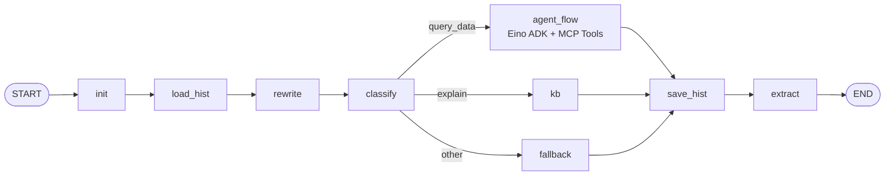

# Eino 广告投放智能助手

一个基于 [CloudWeGo Eino](https://github.com/cloudwego/eino) 的 Go 示例项目，演示如何把大语言模型、MCP 工具、多轮会话历史和 MySQL 持久化组合成一条可运行的广告投放问答链路。

> 当前项目是单进程命令行示例，不是 HTTP 服务。执行 `go run .` 后会自动运行 `main.go` 中预置的 4 个问题。

## 功能概览

- **多轮问题改写**：结合最近 3 条用户历史，把含指代或上下文缺失的问题补全为独立问题。
- **意图分类**：把问题分为 `query_data`（数据查询）、`explain`（概念解释）和 `other`（其他）。
- **MCP 数据查询**：通过 Eino ADK Agent 调用 MCP Server 暴露的工具，并把模型返回结果整理为表格。
- **知识问答**：对广告投放概念进行解释。
- **兜底响应**：无法识别的请求返回固定提示。
- **会话持久化**：将有效的用户问题和助手回答写入 MySQL。

## 处理流程



各节点职责：

| 节点 | 作用 |
| --- | --- |
| `init` | 将输入的 `SessionID` 和 `Query` 转换为图状态。 |
| `load_hist` | 从 MySQL 读取该会话最近 3 条用户消息。 |
| `rewrite` | 使用 LLM 补全多轮对话中的省略和指代。 |
| `classify` | 使用 LLM 识别问题意图。 |
| `agent_flow` | 面向数据查询，运行带 MCP Tools 的 Eino Agent。 |
| `kb` | 面向概念解释，使用 LLM 和会话历史直接回答。 |
| `fallback` | 返回无法处理请求时的兜底文案。 |
| `save_hist` | 将有效的用户消息和回答写入 MySQL。 |
| `extract` | 从图状态中提取最终字符串响应。 |

## 项目结构

```text
.
├── main.go     # 配置、会话存储、Eino 节点、图编排和示例入口
├── go.mod      # Go 模块与依赖版本
├── go.sum      # 依赖校验和
└── README.md
```

## 环境要求

- Go **1.25.7 或更高版本**
- MySQL 5.7+，推荐 MySQL 8.x
- 一个兼容 OpenAI Chat Completions 协议的模型服务
- 一个可通过 **Streamable HTTP** 访问、且暴露数据查询工具的 MCP Server

## 快速开始

### 1. 安装依赖

```bash
go mod download
```

### 2. 初始化 MySQL 表

程序使用 `session_memory` 表保存会话。可以先执行下面的示例 DDL：

```sql
CREATE TABLE IF NOT EXISTS session_memory (
    id BIGINT UNSIGNED NOT NULL AUTO_INCREMENT,
    session_id VARCHAR(128) NOT NULL,
    role VARCHAR(32) NOT NULL,
    content LONGTEXT NOT NULL,
    idx INT NOT NULL,
    PRIMARY KEY (id),
    UNIQUE KEY uk_session_memory_session_idx (session_id, idx),
    KEY idx_session_memory_lookup (session_id, role, idx)
) ENGINE=InnoDB DEFAULT CHARSET=utf8mb4 COLLATE=utf8mb4_unicode_ci;
```

字段约定：

- `role` 使用 `user` 或 `assistant`。
- `idx` 是同一会话内递增的消息序号。
- 当前读取逻辑只加载 `role = 'user'` 的最近 3 条记录；保存逻辑会同时写入用户消息和助手回答。

### 3. 配置外部服务

当前版本尚未接入环境变量或命令行参数，以下配置均直接写在 `main.go` 的 `main()` 函数中：

| 配置项 | 位置 | 说明 |
| --- | --- | --- |
| `APIKey` | `openai.ChatModelConfig` | 模型服务的 API Key。 |
| `Model` | `openai.ChatModelConfig` | 服务端实际支持的模型名称。 |
| `BaseURL` | `openai.ChatModelConfig` | OpenAI 兼容接口地址，通常以 `/v1` 结尾。 |
| MCP URL | `client.NewStreamableHttpClient` | MCP Server 的 Streamable HTTP 地址。 |
| MySQL DSN | `NewMySQLSessionStore` | MySQL 用户名、密码、主机、端口和数据库。 |

DSN 格式如下：

```text
<user>:<password>@tcp(<host>:<port>)/<database>?charset=utf8mb4&parseTime=True&loc=Local
```

运行前请把源码中的示例值替换为自己的配置。示例表结构中的 `idx` 唯一键也建议保留，用于提前暴露序号冲突问题。

### 4. 运行示例

```bash
go run .
```

程序不会进入交互式输入，而是依次执行以下预置问题：

1. 查询清理大师最近 3 天的花费数据。
2. 询问手心输入法 OPPO 媒体的花费。
3. 询问 CTR 计算公式。
4. 询问 `1+1=?`。

这些问题分别覆盖数据查询、多轮改写、概念解释和兜底分支。终端会输出每一步的输入、识别出的意图、最终回答和执行耗时。真实查询结果取决于连接的 MCP Server 及其工具能力。

## 核心实现

### 图状态

`GraphState` 在节点之间传递以下信息：

| 字段 | 含义 |
| --- | --- |
| `SessionID` | 当前会话标识。 |
| `CurrentQuery` | 用户原始问题。 |
| `RewrittenQuery` | 结合历史改写后的问题。 |
| `History` | 从 MySQL 加载的最近用户消息。 |
| `Intent` | 意图分类结果。 |
| `Response` | 当前节点生成的最终回答。 |

### Agent 与 MCP

`query_data` 分支会创建 Eino ADK Agent，并把 MCP Client 获取到的全部 Tools 注入 Agent。Agent 的提示词要求模型优先调用工具查询数据，并尽量用带表头、结构清晰的表格展示结果。

连接到 MCP Server 后，程序会执行初始化并拉取工具列表。若 MCP Server 未正确实现协议、工具不可用或请求超时，Agent 分支将无法完成数据查询。当前 HTTP 超时时间为 1 分钟。

### 历史读写

- 读取：按 `idx` 升序读取最多 3 条 `role = 'user'` 的消息。
- 写入：在同一事务中写入用户消息和助手回答。
- 拦截：空问题、空回答以及包含内部占位文案的回答不会落库。
- 失败策略：历史读取或写入失败会记录日志，但不会中断当前回答。

## 排查问题

| 现象 | 建议检查 |
| --- | --- |
| 初始化 LLM 失败 | API Key、模型名称、Base URL 和网络连通性。 |
| 创建或初始化 MCP Client 失败 | MCP URL、Streamable HTTP 支持、服务端状态及 1 分钟超时限制。 |
| 获取 MCP Tools 失败 | MCP 初始化流程及工具发现接口。 |
| MySQL 连接失败 | DSN、账号权限、数据库名、网络和 MySQL 服务状态。 |
| 查询分支没有有效数据 | MCP 工具是否可用，以及模型是否正确选择了工具和参数。 |
| 多轮问题改写不符合预期 | 数据库中是否存在该 `session_id` 的用户历史，以及模型输出是否稳定。 |
| 回答未写入数据库 | 检查响应是否为空、是否触发异常响应拦截，以及插入时的 `idx` 是否唯一。 |

## 已知限制与生产化建议

- **敏感配置已硬编码**：当前源码直接保存模型、MCP 和 MySQL 配置。公开仓库或部署前必须移除真实密钥与账号，并轮换已经暴露的凭据。
- **配置方式固定**：尚未接入环境变量、配置文件或命令行参数。
- **仅提供命令行示例**：没有 HTTP API、前端、鉴权、限流和请求追踪。
- **日志可能泄露业务数据**：调试输出会打印模型输入和用户问题，生产环境应脱敏。
- **无自动化测试**：可以补充节点单测、MCP 集成测试和 MySQL 测试容器。
- **会话读取策略简化**：只读取最近 3 条用户消息，不读取助手回答。
- **并发写入存在竞争风险**：当前通过 `MAX(idx) + 1` 生成序号，高并发时应改用数据库自增序列、行锁或专门的消息序列表。
- **固定示例入口**：会话 ID 和示例问题写死在 `main.go`，接入真实调用方时需要改为请求驱动。

## 后续可扩展方向

1. 使用 `os.Getenv`、Viper 或配置文件管理外部服务配置。
2. 提供 HTTP/gRPC 接口，并增加会话鉴权、限流和可观测性。
3. 为问题改写、意图分类、路由和历史存储增加单元测试。
4. 将 MCP Tool 错误和模型失败映射为明确的业务错误码。
5. 引入结构化日志，记录会话 ID、意图、耗时和工具调用链，同时避免记录敏感内容。
